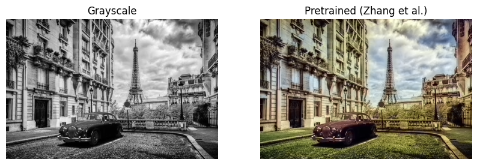
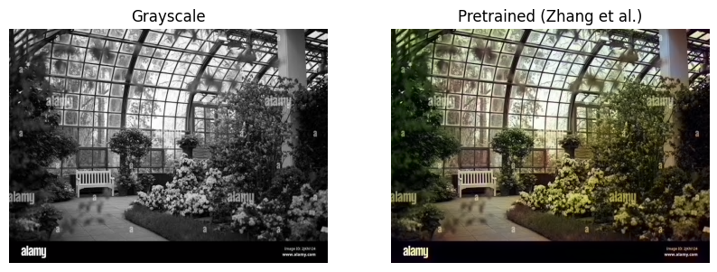
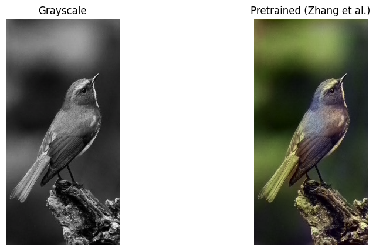
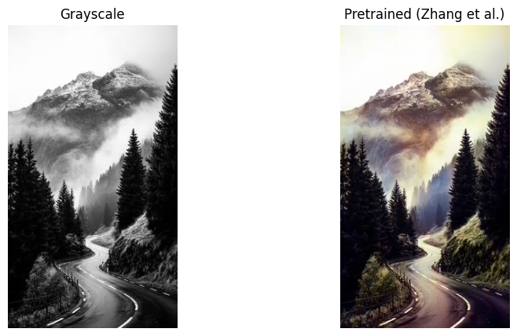

# Old Photo Colorization

Automatically colorizing black-and-white photos using deep learning.

## Overview
- Converts grayscale images to color using a pretrained CNN (Zhang et al., ECCV 2016)
- Works in the LAB color space: the model takes the L (brightness) channel
  and predicts the a, b (color) channels
- Compares the grayscale input with the colorized output side by side

## Tech Stack
Python, PyTorch, scikit-image, Matplotlib, Google Colab (GPU)

## Results

## Observations
- Works well on natural scenes (sky, water, buildings)
- Colors tend to look slightly muted, because the model predicts "average" colors

## How to Run
1. Open `old_photo_colorization.ipynb` in Google Colab
2. Set runtime to GPU (Runtime -> Change runtime type -> T4 GPU)
3. Run the cells in order

## Credits
Pretrained model: [richzhang/colorization](https://github.com/richzhang/colorization)
